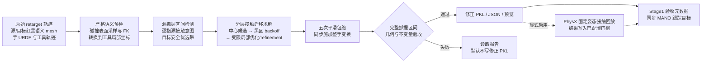

# 几何轨迹修正：代码流程、方法与论文图

核查日期：2026-10-10。以 `main/dataset/contact_trajectory_retarget.py` 当前实现为准。图与本文描述默认 `contact-translation`，可选模块另行标明。

## 1. 核心定位

该模块在 MANO→dexterous-hand retarget 之后、Stage1 之前执行离线几何后处理。目标是在替换工具几何后，将已有右手抓握轨迹迁移到新工具的可接触语义区域，同时尽量保持源轨迹的逐指接触和时间结构，减少对禁止接触区域的接近。

核心思路是：**用源接触意图指导整手刚体迁移，先验证显式几何候选，再对失败情况进行受限修正。** 默认只求一个工具局部平移向量，并用时间包络应用到整段轨迹；手指关节角和腕部朝向保持原值。该过程不会重新求解逐帧 finger IK，也不改变物体运动轨迹。

论文中的英文模块名称可用 **Contact-aware Geometric Trajectory Correction**。

## 2. 总体流程及输入输出



正式图：`figures/geometric_correction_pipeline.pdf`（论文插入）、`.svg`（可编辑文字和节点）、`.png`（预览）。绘图脚本：`figures/render_geometric_correction_pipeline.py`。主图展示模块定位，下方展开分层求解器；兼容求解器不占主图位置。

输入：

| 输入 | 用途 |
|---|---|
| 原始 retarget PKL | 腕位置 `opt_wrist_pos`、腕朝向 `opt_wrist_rot`、关节角 `opt_dof_pos`、可选关节位置 `opt_joints_pos` |
| 源工具语义 mesh | 恢复抓握时段、接触手指、源接触锚点与源红区中心 |
| 目标工具语义 mesh | 定义新红区、黑区、语义轴和安全优选带 |
| 手 URDF | 手部碰撞表面、关节链和离线前向运动学 |
| 物体逐帧位姿 | 工具局部/世界坐标转换及逐帧应用 |
| 目标 collision URDF | 可选 PhysX 回放及碰撞资产一致性核查 |

输出为修正右手 PKL、接触报告 JSON、预览图及验证元数据。Stage1 将同一变换同步到 MANO 腕/关节目标，并重算相关速度和手物距离，保证几何修正目标与训练跟踪目标一致。左手继续使用原始数据。

## 3. 各阶段的实际方法

### 3.1 语义预检和几何重建

新旧工具的每个顶点必须严格分类为红色或黑色，且两类均非空。红色阈值为 `R>150, G<100, B<100`；黑色为各通道 `<80`。缺失颜色或未分类颜色会终止流程。

工具语义点集由该类顶点和该类占多数的三角面重心组成，红/黑各建立 `cKDTree`。手部则从 URDF 碰撞几何进行确定性采样，每个 link 默认最多保留 32 点；同一 link 的多个 collision 元素共享这个额度。mesh 采样按三角面面积分配，再在所选三角面内使用确定性重心坐标生成点。离线 FK 将这些点随原始关节角、腕部位姿移动到世界坐标，然后转换到工具坐标：

\[
x^{\mathrm{tool}}_{t,k}=R_{o,t}^{\top}(x^{\mathrm{world}}_{t,k}-p_{o,t}).
\]

距离查询是**离散语义表面点的最近邻欧氏距离**。论文中应表述为 sampled-surface proximity，而不能将其写成 signed distance field 或精确 mesh 穿透深度。

### 3.2 抓握区间与源接触意图

从源工具的红区接近程度构造抓握帧掩码：默认接近距离 25 mm，以 contact-link 比例判定；填补长度不超过 10 帧的短间隙，选最长连续区间，长度至少 8 帧。不满足时回退到对源工具整个表面的接近检测。也可显式提供起止帧。

在抓握区间内，对配置的接触 links（通常为指端）逐帧查询源红区。默认以 6 mm 严格接触距离和 0.3 接触帧比例选择源活跃 links。该提取过程每个 link 使用到红区最近的采样点，并检查其最近语义归属；无活跃 link 时依次回退到 25 mm 接近条件、最接近 link。

输出三类信息：源活跃 link 集合、每个 link 的源接触时间掩码、源红区接触锚点。每个活跃 link 的锚点为源接触帧所对应红区最近邻的中位数，整体接触中心为各 link 锚点的中位数。这会平衡不同手指的贡献。

### 3.3 目标语义轴与安全优选带

选取距目标红区不超过 30 mm 的局部黑区；无点时选最近约 10% 黑区点。以红区和局部黑区的中位数中心构造黑→红语义方向，对两类的中心化协方差进行平衡并加入中心差外积，再作特征分解。实现选择**与黑→红方向最对齐的特征向量**，随后统一正向。

将目标红区沿该方向投影并归一化至 `[0,1]`，选取 `[0.15,0.35]` 前端带，且到黑区点集距离至少 2 mm。所选带的中位数为目标中心。方向退化、方向对齐度小于 0.5、有效点少于 3 等情况，回退为全红区及其中心。

优选带提供初始落点和诊断量。当前最终可行性门槛没有检查 `preferred_frame_pass_ratio`。

### 3.4 多中心初始化与词典序候选选择

令源接触中心为 \(c_{\rm contact}\)，源红区中心为 \(c_{\rm red}\)，目标优选中心为 \(c_{\rm pref}\)：

\[
c_s(a)=a\,c_{\rm contact}+(1-a)c_{\rm red},\qquad
\Delta(a)=c_{\rm pref}-c_s(a),
\quad a\in\{1,0.75,0.5,0.25,0\}.
\]

`a=1` 对应源接触中心；`a=0` 对应源红区中心。小于 1 mm 平移差的候选合并。所有候选在**完整抓握区间**评估。

按以下词典序排序：通过几何门槛、完整接触级别、保留源 links 数量、最差手指保持率、较小保持率方差、帧覆盖、较小黑区违规比例、较小平移量。存在可行候选则直接输出最佳平移，跳过后续优化。

这一步是显式几何候选搜索，不需要训练模型，也不使用 ICP 点对齐。

### 3.5 黑区 backoff、局部优化与 refinement

直接候选全失败后，若语义轴可靠，取排名前 2 候选向黑→红方向进一步平移。在 `[0,50 mm]` 默认取 11 个距离采样，选第一个可行距离；无可行样本则选损失最低样本。两条 backoff 路径再按候选排名选择。方向不可靠则跳过 backoff，以最佳中心候选进入局部优化。

**此分支移除优选带引导**，目标转为红区接触、源接触保持和黑区避让。仍失败时，用带边界的 Powell 无导数优化求解残差：

\[
\Delta=\Delta_0+r,\qquad |r_i|\le b,
\quad b=10\mathrm{\ mm}.
\]

限制的是每轴残差；初始中心迁移不受该残差上限限制。默认接触模式的 `max_shift=50 mm` 用于 backoff 搜索，不能把它写成最终总平移上限。

局部求解使用最多 48 个代表帧。求解后在完整抓握区间检查；将失败帧与原代表帧合并，再均匀采样至 48 帧，重新求解。最多 4 轮；若代表集未改变则提前停止。优化希望提升到完整源接触保持，最终允许按配置放松验收。

### 3.6 五次平滑包络与整手应用

令 \(w_t\) 为时间包络：抓握区间恒为 1，区间外为 0，前后默认各 20 帧通过五次 smoothstep 渐入渐出：

\[
s(u)=6u^5-15u^4+10u^3,\qquad
p'_t=p_t+w_tR_{o,t}\Delta.
\]

同一逐帧位移用于腕位置、已存储手关节位置和 Stage1 的 MANO 跟踪目标。默认 `opt_wrist_rot`、`opt_dof_pos` 原样复制。五次包络端点的一、二阶导数为零，平滑的是**修正量**；不应据此声称原始轨迹全部速度/加速度已被平滑。

## 4. 优化目标：可以写入方法章节的对应公式

对变换后的手表面采样点 \(x\)，定义其到目标红/黑点集的距离 \(d_R(x),d_B(x)\)。语义修正红区距离为：

\[
\widetilde d_R(x)=d_R(x)+[d_R(x)-d_B(x)+\epsilon]_+,
\qquad D_{t,\ell}=\min_{x\in P_{t,\ell}}\widetilde d_R(x).
\]

其中 \(\epsilon\) 为语义 tie 参数，\(P_{t,\ell}\) 为该帧该 link 的碰撞采样点集。对源活跃 links 和优化代表帧聚合，定义 \(z=\operatorname{clip}(D/\tau_c,0,10)^2\)：

\[
L_{\rm red}=0.7\operatorname{mean}(z)+0.3Q_{0.9}(z),
\qquad
L_{\rm drop}=\operatorname{mean}\left[
\operatorname{clip}\left(\frac{[D-\tau_c]_+}{\tau_c},0,10\right)^2\right].
\]

黑区项对**整手**采样点计算，令

\[
\beta_{t,k}=\mathbf{1}[d_B(x_{t,k})+\epsilon<d_R(x_{t,k})]
\frac{[\tau_b-d_B(x_{t,k})]_+}{\tau_b},
\]

\[
L_{\rm black}=\operatorname{mean}_{t,k}(\beta_{t,k}^2)
+\operatorname{mean}_{t}\left[(\max_k\beta_{t,k})^2\right].
\]

默认局部回退目标：

\[
\boxed{L(r)=L_{\rm red}+2L_{\rm drop}+80L_{\rm black}
+0.05\frac{\|r\|_2^2}{b^2}.}
\]

`_transformed_geometry_objective` 支持额外的 `0.25 L_front`，其结构与红区项相同，但使用到优选带的距离；当前默认局部 fallback 传入 `preferred_region=None`，因此该项为零。源逐帧接触掩码用于候选/验收保持率；优化目标通过源活跃 link 集合鼓励接触，并没有按源逐帧掩码限定损失计算。

## 5. 验收门槛及其实际含义

某帧某 contact-link 的目标红接触成立，当该 link **至少一个**表面点最近语义为红且红区距离不超过 6 mm。黑区违规是整手采样点最近语义为黑且黑区距离小于 6 mm；统计的是采样违规比例，不能等同于 mesh 体积穿透率。

对源活跃 link \(\ell\)，源接触掩码为 \(m_{t,\ell}\)，修正后红接触为 \(c'_{t,\ell}\)：

\[
\eta_\ell=\frac{\sum_t m_{t,\ell}c'_{t,\ell}}{\sum_t m_{t,\ell}}.
\]

若 \(\eta_\ell\ge\rho\)，则该源 link 被计为保留。源活跃数为 \(N_A\)，最低数量为

\[
N_{\rm req}=\max(1,\lfloor\rho N_A\rfloor).
\]

当前 \(\rho=0.4\)。这个参数同时用于逐 link 时间保持率与最低数量计算。向下取整意味着实际保留数量占比可能小于 \(\rho\)，例如四根源活跃 link 最少要求一根。

帧覆盖验收有两条 OR 路径：

1. `r_source`：只对存在源接触的帧，检查保留该帧源接触 links 的动态最低数量；
2. `r_red`：对整个抓握区间，检查目标红接触 links 数量达到 `N_req`，可包含其他配置 links。

最终默认门槛为：

\[
G=(r_{\rm source}\ge0.8\ \lor\ r_{\rm red}\ge0.8)
\land(v_{\rm black}\le10^{-5})
\land(N_{\rm retained}\ge N_{\rm req})
\land\text{变换不变量通过}.
\]

几何通过原子保存 PKL；几何失败默认仅保留报告/预览。全序列指标也会计算，但正式接触/黑区门槛在完整抓握区间上验收。

## 6. 可选模块与兼容模式

| 模块 | 方法及触发条件 | 图中表达 |
|---|---|---|
| Memory bank | `--bank`；仅 translation；中心直通失败后检索同序列相似目标工具前 3 个已验收残差，使用归一化对称 Chamfer 与统计项加权距离。重新验证，通过则直接复用；失败则作为 Powell 初值。全部已配置验收通过才入库 | 虚线旁路；不是前置必经步骤 |
| Contact-SE(3) | 显式选择 `contact-se3`；默认先平移，不能达到完整接触可行时允许以源接触中心为 pivot 的 ≤5° 腕部旋转；残差平移仍有界，finger DOFs 不变。目标再加 `0.02 ||rotvec||² / theta_max²` | 局部求解的可选分支 |
| PhysX | `--physx`；几何通过后隔离进程对最多 24 个代表帧做固定姿态接触回放，检查接触覆盖、接触包络、力和有限性。失败仍保存几何 PKL，但已配置物理门槛不通过会阻止 Stage1 | 几何之后的可选验证 |
| semantic-axis | 兼容模式；\(\Delta=d\,u,\ 0\le d\le50\rm\ mm\)，201 点粗搜加有界标量细化 | 附录/消融，不放主流程 |
| free3d | 兼容模式；三轴自由搜索，differential evolution 加 Powell | 附录/消融，不放主流程 |

固定姿态 PhysX 验证检查碰撞响应；完整任务的动态稳定性仍由 Stage1 中工具运动、重力、摩擦和控制共同验证。

## 7. 论文图注与正文草稿

中文图注：**接触感知几何轨迹修正流程。** 原始重定向轨迹通过手部碰撞表面前向运动学转换到工具局部坐标，并从源工具提取抓握区间和逐指接触意图。分层求解器先将源接触/红区中心的插值候选映射到目标安全优选带；直接候选失败后，依次执行远离黑区的轴向回退和受限局部优化。求得的整手修正经五次时间包络应用到轨迹，在完整抓握区间检查红区接触、源接触保持、黑区违规和变换不变量。默认保持手指关节角及腕部朝向；虚线表示可选残差记忆、小角度腕部旋转和 PhysX 回放验证。Stage1 使用通过已配置门槛的修正轨迹和同步 MANO 跟踪目标。

English caption: **Contact-aware geometric trajectory correction.** Collision-surface forward kinematics reconstructs the retargeted hand in tool coordinates, where the source grasp interval and per-link contact intent are extracted. The hierarchical solver first evaluates interpolated source-center mappings to a safe target band, followed by black-region backoff and bounded local refinement when direct candidates fail. A quintic temporal envelope applies the correction to the whole hand. Geometry and motion invariants are checked over the full grasp interval before the corrected trajectory is used by Stage 1 with synchronized MANO tracking targets. The default mode preserves finger joint angles and wrist orientation. Dashed branches indicate optional residual-memory reuse, bounded wrist rotation, and fixed-pose PhysX validation.

正文可用：我们在原始手部运动重定向后进行接触感知的几何轨迹修正，以适配替换工具的语义接触区域。通过离线碰撞表面前向运动学，我们在工具坐标系中提取源抓握区间、接触 links 及其接触时间掩码，并使用目标工具红黑语义构造安全优选带。我们首先验证一组源接触中心与源红区中心的插值迁移候选，依据可行性和逐指接触保持质量选择结果。直接候选失败时，求解器先执行远离黑区的轴向回退，再通过受限平移残差优化红区接触、接触保持和黑区避让。最终将整手修正以五次时间包络应用到运动序列，并在完整抓握区间执行几何和姿态不变量验收。

## 8. 代码索引与需要统一的旧文档表述

| 方法 | 代码位置 |
|---|---|
| 主调度及输入 | `main/dataset/contact_trajectory_retarget.py:2824` |
| 手碰撞 FK | 同文件 `:292`、`:434` |
| 语义校验/点集 | 同文件 `:731`、`:769` |
| 坐标转换 | 同文件 `:801` |
| 抓握区间/意图 | 同文件 `:1266`、`:1662` |
| 语义轴/优选带 | 同文件 `:1349`、`:1569` |
| 候选排名/生成 | 同文件 `:1866`、`:1940` |
| backoff/Powell/SE(3) | 同文件 `:2011`、`:2102`、`:2196` |
| 目标函数 | 同文件 `:1758` |
| 失败帧 refinement | 同文件 `:3471` |
| 五次平滑/应用 | 同文件 `:929`、`:3601` |
| 几何门槛/正式验收 | 同文件 `:2478`、`:2509`、`:3697` |
| 可选 PhysX/输出 | 同文件 `:2606`、`:3734`、`:3950` |
| 记忆描述符/检索 | `main/contact_retarget_memory.py:134`、`:191`、`:257` |
| Stage1 同步与门槛 | `main/dataset/base.py:203`、`:275`、`:412` |

已有 `docs/contact_trajectory_retargeting.md` 存在遗留说明，本文和图以代码为准：

- `min_contact_retention_ratio` 当前默认 0.4；0.8 是默认合格帧比例。`relaxed_80` 是遗留状态字符串。
- 回退继续使用排名最高候选/backoff 初值，不强制恢复源红区中心映射。
- 优选带占用没有进入最终硬门槛；`min_preferred_frame_ratio` 默认 0.7 不构成当前 `_is_feasible` 的条件。
- 几何有效 PKL 的保存不要求可选 PhysX 必须通过；Stage1 读取资格仍受已配置物理门槛控制。
- SE(3) 模式同步的是刚体变换，默认 translation 模式同步的是刚体平移。

本次仅新增方法整理与插图产物，没有修改算法或已有操作文档。

## 9. 实际调度、阶段数据与进一步核查

### 9.1 阶段之间传递的数据

| 阶段输出 | 数据结构/含义 | 下一阶段用途 |
|---|---|---|
| 原始轨迹 | 腕位置 `[T,3]`、腕旋转向量 `[T,3]`、关节角 `[T,D]` | 重建手碰撞表面 |
| 物体轨迹 | `[T,4,4]` 刚体变换 | 世界/工具局部转换 |
| 整手表面轨迹 | `points_before: [T,P,3]`，每个点对应 link ID | 源接触提取、目标距离查询 |
| 抓握区间 | 闭区间 `[start_frame,end_frame]` | 候选全量评估、代表帧采样 |
| 源接触意图 | 活跃 links `[L]`、源时间掩码 `[H,L]`、接触中心 `[3]` | 迁移初始化、接触保持验收 |
| 目标优选区域 | 带内点集、KD-tree、中位数中心、语义轴报告 | 中心候选与 backoff |
| 局部求解结果 | 固定工具局部平移 `[3]` 或 SE(3) `[4,4]` | 构造逐帧时间包络 |
| 应用结果 | 修正轨迹、包络 `[T]`、可选变换序列 `[T,4,4]` | 最终验收、Stage1 同步 |

其中 `T` 为总帧数，`P` 为整手采样点数，`D` 为手 DOFs，`L` 为配置 contact links 数，`H` 为抓握区间帧数。需要区分：接触保持以指定 contact links 统计，黑区避让覆盖整手碰撞采样点。

### 9.2 默认分支的调度伪代码

```text
加载源 retarget、工具轨迹、新旧语义 mesh、手 URDF
语义/长度/DOF 预检
通过 FK 得到工具局部整手点序列
检测抓握区间，提取源接触意图，构造目标优选带
对五个中心迁移候选去重、全抓握区间评估和排序

若最佳中心候选可行：
    直接选择，跳过 backoff / bank / Powell / refinement
否则：
    移除优选带引导
    若语义轴可靠：
        对前两个候选分别 backoff，选择最佳结果
    否则：
        使用最佳中心候选作为初始化

    若 --bank：
        检索并评估 top-3 历史残差（发生在 fallback 分支）

    若 backoff 已可行：直接选择，跳过 Powell / refinement
    否则若历史残差可行：直接选择该迁移残差
    否则：Powell 优化局部残差（可用历史残差作初值）

    若 contact-se3 且回退结果没有直接通过：
        全区间判断纯平移是否满足完整接触可行
        不满足才允许有界小旋转联合求解

    执行有上限的失败帧 refinement

构造五次时间包络，应用到轨迹
完整抓握区间几何验收 + 全轨迹变换不变量检查
若启用且几何通过：执行隔离进程 PhysX
保存报告/预览，几何通过则保存修正 PKL
若 --bank 且所有已配置验收通过：保存记忆条目
```

细节：当前实现即使 backoff 已可行，也可能先评估启用的 bank 候选，但最终优先采用 backoff。`direct_geometry_passed` 只对中心直通或 backoff 直通路径设置；memory 直通仍会进入 refinement 检查，若达不到完整接触目标可能继续优化。因此“memory direct”表示跳过首轮 Powell，不保证完全跳过之后的 refinement。

### 9.3 不变量检查

`_invariant_report` 比较输出与预计逐帧变换，检查轨迹有限性、手指 DOFs 最大误差 ≤`1e-10`、腕位置/腕旋转/已存储关节位置变换误差 ≤`1e-6`。translation 模式预计腕旋转等于源旋转；SE(3) 模式预计腕旋转等于应用变换后的旋转。

所以 SE(3) 的 `rotation_max_abs_error=0` 指对预计变换的误差为零，不表示输出腕部朝向与源朝向相同。

### 9.4 PhysX 实际回放细节

入口为 `contact_trajectory_retarget.py:2606`，执行器为 `contact_trajectory_physics_validate.py:221`。

1. 从完整抓握区间均匀抽取最多 24 个代表帧，向独立子进程传递修正腕姿、手指角度、工具姿态和资产路径。隔离进程满足 Isaac Gym 必须先于 torch 导入的要求。
2. 每个代表帧创建独立环境，加载真实手 URDF 和工具 collision URDF。两者固定基座并关闭资产重力；手关节采用 PD 位置目标，stiffness=400、damping=40。此处手指会在接触和 PD 下响应，但不回写离线 PKL。
3. 每个 shape 设置摩擦 1、contact offset 3 mm、rest offset 0，默认运行 8 步，时间步长 1/60 s、substeps=2。
4. 查询工具刚体相关接触，统计工具接触帧率、指定 links 接触帧率、逐 link 接触帧率、最大 `initialOverlap` 和最大 `abs(lambda)/dt`。
5. 当前主程序传入的门槛：工具接触帧率 ≥0.5；至少一个指定 link 接触的帧率 ≥0.5；达到逐 link 接触帧率 0.5 的源活跃 links 至少为 `N_req`；最大接触包络 ≤10 mm；最大求解器力估计 ≤50000；接触数值有限。helper 自身的缺省力阈值不同，主程序会显式覆盖，应按主程序参数报告。
6. 非 headless 时，在独立验证之后创建 Viewer 循环播放全轨迹。Viewer 只更新姿态并绘制，不调用 `simulate`；它与正式 PhysX 指标计算是两个环节。

此物理检查不区分碰撞点的红黑颜色；红黑语义由前面的几何门槛负责。

### 9.5 保存、独立复验与训练读取

| 几何层 | PhysX 配置/结果 | 保存修正 PKL | Stage1 门槛 |
|---|---|---|---|
| 通过 | 未请求 | 保存 | 几何等已配置条件通过则可读 |
| 通过 | 请求且通过 | 保存 | 可读 |
| 通过 | 请求且失败 | 保存失败元数据 | 拒绝 |
| 失败 | 自动跳过 | 默认不保存，诊断开关例外 | 拒绝 |

独立 `verify` 会重新从源/修正 PKL、mesh 和手 URDF 重建接触指标，并检查新旧 mesh、碰撞资产 bundle 哈希和变换不变量；它检查已存储的验证层状态，**不重新运行 PhysX**。

Stage1 读取修正 dex-hand 轨迹，并根据元数据中的局部位移和包络，或 SE(3) 变换序列，对原 MANO 跟踪目标施加同样变换，更新速度、角速度和手物距离。这样 wrist/DOF 模仿目标与 MANO 关节跟踪目标在几何修正后保持一致。
